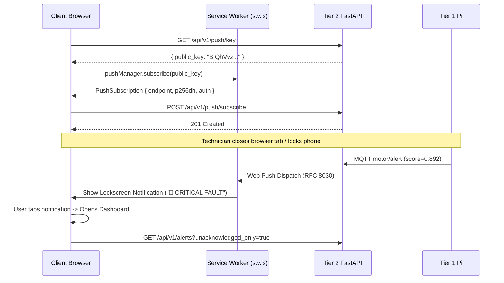

# 🌐 Tier 3: Web Client App Architecture & Build Plan

> **Role**: Remote user-facing dashboard in the 3-Tier Decoupled Predictive Maintenance Architecture.  
> Runs entirely decoupled from the Raspberry Pi on technician laptops, tablets, and smartphones, consuming the **Tier 2 Server API** via WebSockets, REST, and W3C Web Push Notifications.

---

## 1. System Context & Tier 3 Data Flow

```
┌─────────────────────────────────────────────────────────────────────────────┐
│                         TIER 1: EDGE (Raspberry Pi 4)                       │
│  Headless Python daemon: Samples I2C sensor, runs 1D-CNN CPU inference      │
└──────────────────────────────────────┬──────────────────────────────────────┘
                                       │ MQTT (QoS 1)
                                       ▼
┌─────────────────────────────────────────────────────────────────────────────┐
│                         TIER 2: SERVER BACKEND (FastAPI)                    │
│                                                                             │
│   • REST API (/api/v1/*)           • WebSocket Stream (/ws/telemetry)       │
│   • Push Dispatcher (RFC 8030)     • Retained MQTT (`motor/status`)         │
└──────────────┬───────────────────────────────┬──────────────────────────────┘
               │ REST                          │ WebSocket / Web Push
               ▼                               ▼
┌─────────────────────────────────────────────────────────────────────────────┐
│                     TIER 3: CLIENT APPLICATION (Web / PWA)                  │
│                                                                             │
│   ┌─────────────────────────────────────────────────────────────────────┐   │
│   │                        Service Worker (sw.js)                       │   │
│   │   • W3C Push Event: Triggers background lockscreen banner & chime   │   │
│   │   • Notification Click: Opens / focuses dashboard to alert details  │   │
│   └──────────────────────────────────┬──────────────────────────────────┘   │
│                                      │                                      │
│   ┌──────────────────────────────────▼──────────────────────────────────┐   │
│   │                     Interactive Web Dashboard                       │   │
│   │                                                                     │   │
│   │   1. Real-Time Telemetry Stream & Anomaly Score Timeline (Chart.js) │   │
│   │   2. Motor Health Status Badge (NORMAL / WARNING / CRITICAL)        │   │
│   │   3. 👨‍🔧 Human-in-the-Loop Feedback Review Modal:                     │   │
│   │        • [✅ Confirm Fault] ──► POST /api/v1/feedback (retraining)   │   │
│   │        • [❌ False Alarm]   ──► POST /api/v1/feedback (tau * 1.05)   │   │
│   │   4. Pending Alerts Drawer & Review Queue                           │   │
│   │   5. Web Push Notification Toggle & Test Chime                      │   │
│   │   6. Remote Threshold Calibration Panel                             │   │
│   └─────────────────────────────────────────────────────────────────────┘   │
└─────────────────────────────────────────────────────────────────────────────┘
```

---

## 2. Core Architectural Principles

1. **Zero Direct Edge Coupling**:
   - The Web Client **never** opens connections or binds ports directly to the Raspberry Pi.
   - All data originates from Tier 2 (`/api/v1/*`, `/ws/telemetry`).

2. **Zero-Build, Modern Native Web Stack**:
   - Built with **HTML5, Modern ES6+ JavaScript, Tailwind CSS (via CDN), and Chart.js**.
   - **Why Zero-Build**: Eliminates brittle Node.js toolchains, 500 MB `node_modules`, and compilation overhead. It loads instantly in any modern browser (Chrome, Edge, Firefox, Safari iOS/macOS) and can be served directly by FastAPI as static assets or hosted independently on Nginx/Cloudflare/Vercel.

3. **Hybrid Pub/Sub & Disconnected Resilience**:
   - **When Closed / Asleep**: Service Worker listens to background Web Push notifications via VAPID.
   - **When Opened / Resumed**:
     - Runs **Catch-Up Sync**: Calls `GET /api/v1/telemetry/history` and `GET /api/v1/alerts?unacknowledged_only=true`.
     - Connects to `/ws/telemetry` with automatic exponential backoff reconnection.

4. **Progressive Web App (PWA) Installable**:
   - Includes `manifest.json` with icons and standalone display mode so technicians can tap "Add to Home Screen" on Android / iOS and use it like a native mobile app.

---

## 3. Directory & File Structure

```
client/
├── client_plan.md           # Master Tier 3 architecture plan (this document)
├── index.html               # Main Single-Page Application (SPA) dashboard layout
├── manifest.json            # PWA manifest (app name, colors, standalone icons)
├── sw.js                    # Service Worker (Web Push listener & notification handler)
├── css/
│   └── styles.css           # Custom animations, dark-mode styling & gauge design
└── js/
    ├── config.js            # API & WebSocket endpoints configuration
    ├── api.js               # REST API client wrapper (telemetry, alerts, feedback, config)
    ├── ws.js                # WebSocket client with heartbeat and auto-reconnect
    ├── charts.js            # Chart.js time-series streaming manager
    ├── push.js              # Web Push subscription lifecycle (VAPID key -> Uint8Array -> sub)
    └── app.js               # Application orchestrator, event bus, and UI state manager
```

---

## 4. UI Component Breakdown

### 1. Header & Connectivity Status Bar
* System Title & Connected Motor ID (`motor_1`).
* Real-time connection pills:
  * **Server API**: 🟢 Online / 🔴 Disconnected
  * **Edge Pi**: 🟢 Live Heartbeat (last sample $<15\text{s}$ ago) / 🟡 Stale
  * **Live Stream**: 🟢 WebSocket Connected / 🟡 Reconnecting
* Push Notification quick toggle: `[🔔 Enable Push]` / `[🔔 Push Active]`.

### 2. Motor Health Status Card (Hero Widget)
* **Status Badge**:
  * `NORMAL` (Green): Anomaly score $\mathcal{L}_{\text{MSE}} \le \tau$.
  * `WARNING` (Yellow): Score approaching threshold ($0.85 \cdot \tau \le \text{score} \le \tau$).
  * `CRITICAL FAULT` (Red): Score breached threshold ($\text{score} > \tau$).
* **Metrics**:
  * Current Score: e.g. `0.0028`
  * Active Threshold $\tau$: e.g. `0.0506`
  * Diagnosis: `Healthy` / `Ball Fault` / `Inner Race Fault` / `Outer Race Fault`
  * Confidence: e.g. `99.8%`
  * Edge Latency: e.g. `0.5 ms`

### 3. Real-Time Anomaly Score Timeline (Chart.js)
* Rolling 60-sample window (10 minutes of operation).
* **Line 1 (Cyan / Amber / Red)**: Dynamic Anomaly Score $s[t]$.
* **Line 2 (Dashed Red)**: Active Threshold $\tau$.
* Visual breach indicators whenever $s[t] > \tau$.

### 4. 👨‍🔧 Human-in-the-Loop Active Feedback Modal
When a critical alert is triggered or selected from the drawer, an interactive review card appears:
* Displays the anomalous window's snapshot, score, threshold, and ML diagnosis.
* **Technician Action 1: [✅ Confirm Fault]**:
  * Logs the failure for offline retraining.
  * Submits `POST /api/v1/feedback` (`event: "CONFIRMED_FAULT"`).
  * Automatically marks alert as acknowledged.
* **Technician Action 2: [❌ False Alarm]**:
  * Informs technician of dynamic self-tuning:
    $$\tau_{\text{new}} = \max\left(\tau, \; 1.05 \cdot \text{score}\right)$$
  * Submits `POST /api/v1/feedback` (`event: "FALSE_ALARM"`).
  * Tier 2 updates config and immediately publishes update to Raspberry Pi over MQTT.
  * Chart updates the threshold line live!

### 5. Pending Alerts Drawer & History
* Badge counter showing active unreviewed alerts.
* Expandable table listing: Timestamp, Score, Diagnosis, Action buttons (`[Review]`, `[Acknowledge]`).

### 6. Remote Configuration & Threshold Tuning
* View active threshold $\tau$.
* Input field for manual engineering override (`POST /api/v1/config/threshold`).
* `[Test Push Chime]` button calling `POST /api/v1/push/test`.

---

## 5. Web Push & Service Worker Architecture

### The Subscription Flow


---

## 6. Server Integration & Deployment

The Web Client will be mounted directly in `server/main.py`:
```python
from fastapi.staticfiles import StaticFiles

# Serve Tier 3 Web Client at http://<server>:8000/
app.mount("/", StaticFiles(directory="client", html=True), name="client")
```

This delivers three major operational advantages:
1. **Single Port (`8000`)**: Both REST API, WebSockets, and Web Dashboard run on the same origin, completely avoiding CORS restrictions and port forwarding complexities.
2. **Same-Origin Service Worker**: The browser can register `/sw.js` with full root scope (`/`).
3. **Zero Extra Process**: Starting `uvicorn server.main:app` starts both the backend API and the live client app simultaneously.

---

## 7. Implementation Milestones

| Step | Milestone | Files |
|:---:|---|---|
| **1** | **PWA Manifest & Service Worker** | `client/manifest.json`, `client/sw.js` |
| **2** | **API & WebSocket Modules** | `client/js/config.js`, `client/js/api.js`, `client/js/ws.js` |
| **3** | **Chart & Push Managers** | `client/js/charts.js`, `client/js/push.js` |
| **4** | **HTML Dashboard UI & Styles** | `client/index.html`, `client/css/styles.css` |
| **5** | **App Orchestrator** | `client/js/app.js` (HITL feedback, catch-up sync, state management) |
| **6** | **FastAPI Static Mount** | Update `server/main.py` with static client mounting |
| **7** | **Verification Test Suite** | `tests/test_client_serving.py` verifying static delivery, SW headers, and API wiring |
