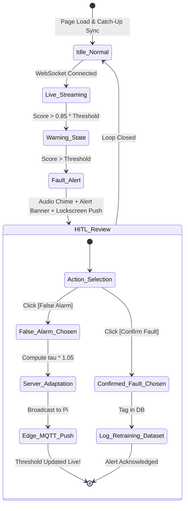

# 🎨 Tier 3: Web Client UI/UX Design & Architecture Specification

> **Design Goal**: Create an industrial-grade, mission-critical predictive maintenance dashboard that combines high visual appeal (modern dark industrial aesthetic, glowing neon telemetry, glassmorphism) with rapid decision-making UX for factory technicians.

---

## 1. Visual Theme & Design Tokens

### Color Palette (Cyber-Physical Dark Mode)
```
Background Deep:       #0a0f1d  (Dark navy canvas)
Surface / Cards:       #11192d  (Slate slate-900 surface with subtle 1px border)
Card Border:           #1e293b  (Subtle zinc/slate border with 40% opacity)
Surface Hover:         #1e2942

Accent Telemetry:      #06b6d4  (Electric Cyan — primary active data stream)
Status Normal:         #10b981  (Emerald Green — healthy operation, within threshold)
Status Warning:        #f59e0b  (Amber / Gold — approaching 85% of threshold)
Status Critical:       #ef4444  (Crimson / Coral Red — threshold breach / fault)
Threshold Marker:      #f43f5e  (Rose Red dashed line)
Text Primary:          #f8fafc  (Bright white)
Text Muted:            #94a3b8  (Slate-400 for units and labels)
```

### Typography
* **UI & Body**: `Inter`, `-apple-system`, `sans-serif` (clean, ultra-legible).
* **Telemetry & Numeric Values**: `ui-monospace`, `JetBrains Mono`, `Roboto Mono` with `font-variant-numeric: tabular-nums;` to prevent numbers from jumping during live updates.

---

## 2. Wireframe & Desktop Layout

```
┌────────────────────────────────────────────────────────────────────────────────────────────────────────┐
│  ⚡ VIBRA-GUARD // Edge AI Motor Sentinel        [Motor #1 - Centrifugal Pump ▼]   [🔔 Enable Push]    │
│  🟢 Edge Pi: 3.2s ago  │  🟢 Server: Online  │  🟢 Stream: Live  │  🔊 Audio: On     ⚙️ Settings       │
├────────────────────────────────────────────────────────────────────────────────────────────────────────┤
│                                                                                                        │
│  ┌──────────────────────────────────────────────────────────────────────────────────────────────────┐  │
│  │ 🟢 MOTOR STATUS: NORMAL OPERATION                                               HEALTH SCORE     │  │
│  │                                                                                  ┌─────────────┐ │  │
│  │   Current Score:  0.00287        Threshold (τ): 0.05060                           │   98.2%     │ │  │
│  │   Diagnosis:      Healthy        Confidence:    100.0%                           │   HEALTHY   │ │  │
│  │   Edge Latency:   0.42 ms        Detector:      Two-Stage Hybrid (1D-CNN)        └─────────────┘ │  │
│  │                                                                                                  │  │
│  │   [ ■■■■□□□□□□□□□□□□□□□□□□□□□□□□□□□□□□□□□□□□□□□□□□□□□□ ] 5.6% of threshold                       │  │
│  └──────────────────────────────────────────────────────────────────────────────────────────────────┘  │
│                                                                                                        │
│  ┌───────────────────────────────────────────────────────────┐ ┌──────────────────────────────────────┐  │
│  │ 📈 REAL-TIME ANOMALY RECONSTRUCTION SCORE (10-Min Live)   │ │ 🚨 ACTIVE ALERTS & TRIAGE            │  │
│  │                                                           │ │                                      │  │
│  │  Score                                                    │ │  [All (14)]  [Unreviewed (1) ⚠️]     │  │
│  │   1.0 ┤                                                   │ │ ──────────────────────────────────── │  │
│  │       │                                                   │ │  ⚠️ Inner Race Fault                 │  │
│  │   0.5 ┤                   ·- - - - - - - - Threshold (τ)  │ │     Score: 0.8924 | 2m ago           │  │
│  │       │                  / \                              │ │     [Review & Calibrate]             │  │
│  │   0.0 └───/\────/\──────/───\────────/\───── Live MSE ─── │ │ ──────────────────────────────────── │  │
│  │          10m    8m      6m   4m      2m     Now           │ │  ✅ Outer Race Fault (Reviewed)      │  │
│  │                                                           │ │     Score: 0.8041 | 15m ago          │  │
│  │  ● Live Streaming (Every 10s)         [Reset Zoom]        │ │     Action: Confirmed Fault          │  │
│  └───────────────────────────────────────────────────────────┘ └──────────────────────────────────────┘  │
│                                                                                                        │
│  ┌──────────────────────────────────────────────────────────────────────────────────────────────────┐  │
│  │ 👨‍🔧 HUMAN-IN-THE-LOOP ACTIVE REPAIR & FEEDBACK COMMAND CENTER                                       │  │
│  │                                                                                                  │  │
│  │  Active Alert Selected: Window #105 — Score: 0.8924 (Breached Threshold: 0.0506)                 │  │
│  │                                                                                                  │  │
│  │  ┌──────────────────────────────────────────────┐  ┌───────────────────────────────────────────┐ │  │
│  │  │  ❌ FALSE ALARM (Dynamic Self-Tuning)        │  │  ✅ CONFIRM MECHANICAL FAULT              │ │  │
│  │  │                                              │  │                                           │ │  │
│  │  │  Adjusts Edge Threshold dynamically:         │  │  Flags bearing defect for overhaul.       │ │  │
│  │  │  τ_new = 0.8924 * 1.05 = 0.93702             │  │  Logs window for supervised retraining.   │ │  │
│  │  │                                              │  │                                           │ │  │
│  │  │  [ Apply τ = 0.93702 & Push to Pi ]          │  │  [ Confirm Fault & Log for Maintenance ]  │ │  │
│  │  └──────────────────────────────────────────────┘  └───────────────────────────────────────────┘ │  │
│  └──────────────────────────────────────────────────────────────────────────────────────────────────┘  │
└────────────────────────────────────────────────────────────────────────────────────────────────────────┘
```

---

## 3. Detailed Component UX Specifications

### 1. Navigation & System Status Bar
* **Branding**: `VIBRA-GUARD` with glowing turquoise pulse indicator.
* **Telemetry Heartbeat Pill**:
  * Calculates `time_since_last_packet = now - last_telemetry.timestamp`.
  * If $<15\text{s}$: Displays `🟢 Edge Pi: 3s ago` (Pulsating green dot).
  * If $>15\text{s}$: Displays `🟡 Edge Pi: Stale (45s)` (Amber alert).
  * If $>60\text{s}$: Displays `🔴 Edge Pi: Offline` (Red warning).
* **Push Notification Quick Button**:
  * If unsubscribed: Highlighting button with bell icon: `[🔔 Enable Push Notifications]`.
  * If subscribed: Subtle emerald badge: `[✓ Push Active]`.
* **Audio Mute/Unmute**:
  * Synthesized alert buzzer toggle (Web Audio API 880 Hz harmonic beep on threshold breach).

### 2. Motor Health Status Card (Hero Element)
* **Background Gradient Glow**:
  * Normal: Subtle emerald radial glow (`rgba(16, 185, 129, 0.05)`).
  * Warning: Amber gradient (`rgba(245, 158, 11, 0.08)`).
  * Fault: High-contrast crimson breathing pulse animation (`@keyframes pulse-critical`).
* **KPI Metrics Grid**:
  * **Score vs Threshold Bar**: Visual horizontal gauge showing the score position relative to the critical threshold.
  * **ML Diagnosis Badge**: Distinct color-coded pills:
    * `Healthy` (Emerald)
    * `Ball Fault` (Orange)
    * `Inner Race Fault` (Red)
    * `Outer Race Fault` (Purple)
  * **Confidence**: Percentage with circular ring indicator.
  * **Edge CPU Latency**: Shows that edge inference completed in $<1\text{ ms}$.

### 3. Real-Time Anomaly Score Timeline (Chart.js)
* **Canvas Styling**: Clean dark gridlines (`#1e293b`), glow effect under the curve using linear gradient fill.
* **Dynamic Threshold Line**:
  * Plotted in dashed crimson/rose (`#f43f5e`).
  * When a technician clicks **[False Alarm]**, the threshold line visually animates upward to the new adapted value in real time!
* **Points & Breaches**:
  * Normal points: Cyan dots (`#06b6d4`).
  * Breach points ($\text{score} > \tau$): Enlarged red hazard dots with pulse animation.

### 4. 👨‍🔧 Human-in-the-Loop Feedback Command Center
The core differentiator of this system. Instead of being buried in a sub-menu, it is front-and-center when an anomaly is under review:
* **The False Alarm Card**:
  * Clear explanation: *"Identifies this vibration window as harmless operating variation (e.g., transient load spike)."*
  * Real-time calculation preview:
    $$\tau_{\text{new}} = \max\left(\tau, \; 1.05 \cdot \text{score}\right)$$
  * One-click trigger that sends `POST /api/v1/feedback`, updates SQLite WAL, publishes over MQTT to the Pi, and updates the UI threshold without a page reload.
* **The Confirm Fault Card**:
  * Clear explanation: *"Confirms a true mechanical failure. Flags bearing for replacement and saves vibration raw spectra for future model fine-tuning."*
  * Optional quick-select tags: `[Bearing Play]` `[Rotor Imbalance]` `[Mounting Loose]`.

### 5. Alerts Review Drawer
* List of unacknowledged alerts with immediate triage:
  * Timestamp (relative + exact ISO).
  * Severity badge.
  * Quick-action buttons: `[Review]` (loads alert into HITL Command Center) and `[Dismiss]`.

### 6. Mobile & Responsive Layout
* Mobile-first stack layout on screens $<768\text{px}$.
* Floating Action Button (FAB) for quick alert triage on mobile screens.
* Bottom navigation bar for switching between **Live Monitor**, **Alerts**, and **Settings**.

---

## 4. Interaction States & Transitions



---

## 5. Web Audio API Acoustic Alerting
To ensure technicians hear alerts even if looking away from the screen:
* High-frequency double pulse chime (880 Hz followed by 1174 Hz) synthesized directly in browser using native Web Audio `AudioContext` and `OscillatorNode` (zero external `.mp3` files needed).
* Mute toggle persists preference in `localStorage`.
